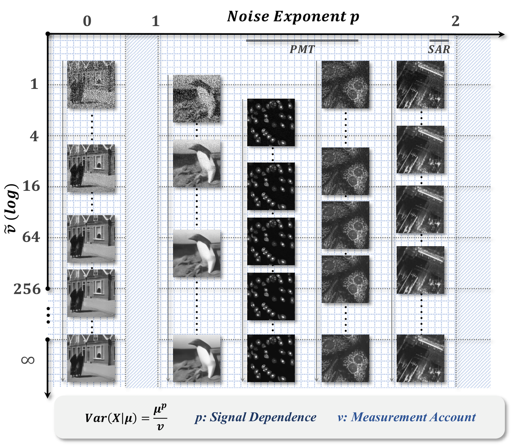
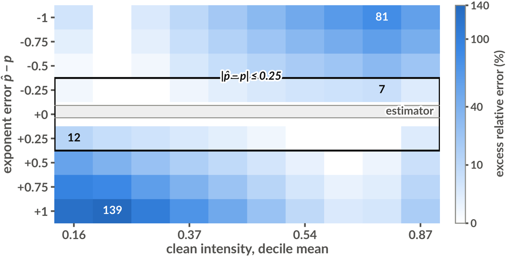

<div align="center">

# p-Bridge

### _One Diffusion Bridge Across Exponent and Dispersion_


[](https://www.python.org/)
[](https://pytorch.org/)
[](LICENSE)

<br/>


</div>

<br/>

Official implementation of *The Noise Plane: A Diffusion Bridge Across Exponent and Dispersion*.

p-Bridge indexes a diffusion bridge by two physical quantities: the **power-variance exponent** `p` and the **cumulative measurement weight** `ν`. A single family covers the Tweedie exponents `p ∈ [1, 2]`: Poisson shot noise at `p = 1`, gamma speckle at `p = 2`, compound Poisson–gamma in between. Every intermediate state is a physically valid measurement at weight `ν(t)`, the reverse posterior is `p`-independent in closed form, and the training loss is the Bregman divergence of the corresponding unit deviance, so one conditional network spans the whole axis and is told the exponent at inference rather than retrained for it.

---

## The Noise Plane

Noise is located by a point `(p, ν)` on a plane rather than by a scalar level: the variance law `Var(X | μ) = μ^p / ν` separates how strongly the fluctuation depends on the signal (`p`) from how much measurement went into it (`ν`). Gaussian noise, Poisson shot noise, photon-counting detectors and SAR speckle are then columns of one family rather than four problems, and a single network is told where on the plane it is working instead of being retrained for each column.

<div align="center">
  
</div>

Because `ν` carries `p`-dependent units, holding it fixed across exponents is meaningless; runs are instead calibrated by a severity `η := CV(μ_ref)`, which equalises the amount of noise at a reference intensity and leaves only its shape to differ.

| η | p = 1.0 | p = 1.5 | p = 2.0 |
|:---|:---|:---|:---|
| 0.25 — mild | ν_obs = 34.42 | 23.47 | 16.00 |
| 0.5 — moderate | 8.60 | 5.87 | 4.00 |
| 1.0 — severe | 2.15 | 1.47 | 1.00 |

`ν_obs(p) = η⁻² μ_ref^(p−2)` with `μ_ref = 0.464864`, the mean intensity of the BSDS500 + DIV2K pool; `ν_max = 10⁴ ν_obs`. At `p = 1, η = 1` this is exactly one photon per pixel at `μ_ref`.

---

## Repository Layout

```
p-Bridge/
├── train.py                  training loop, one exponent per run or p drawn per batch
├── calibration.json          precomputed mu_ref and the nu_obs(p) table
├── pbridge_core/
│   ├── tweedie.py            V(mu), unit deviance, forward sampler, thinning kernels
│   ├── diffusion.py          PBridge: schedule, training couple, reverse chain
│   ├── network.py            UNet + log-nu (and optional p) conditioning
│   └── gd/                   guided-diffusion UNet blocks
├── data/                     BSDS500 loader + downloader, paired eval set
├── eval/                     PSNR / SSIM, per-decile, Pearson-residual diagnostics
├── scripts/calibrate.py      mu_ref and the severity table -> calibration.json
├── tests/                    pytest unit tests, run before any training
└── assets/                   paper figures used by this README
```

---

## Installation

```bash
conda create -n pbridge python=3.10 -y
conda activate pbridge

pip install -r requirements.txt
pip install torch torchvision --index-url https://download.pytorch.org/whl/cu121
```

Verify the simulator against the theory before training anything:

```bash
python -m pytest tests/ -q
```

---

## Pretrained Model

The flagship conditional checkpoint — one network spanning the whole axis — is on the Hugging Face Hub at [Teriri1999/p-Bridge](https://huggingface.co/Teriri1999/p-Bridge).

```bash
hf download Teriri1999/p-Bridge pbridge_cond_severe_50k.pt --local-dir weights
```

EMA weights at step 50,000, 15.28 M parameters, 61.2 MB, `sha256 c7f35c2a…cdf356`. Trained on BSDS500 + DIV2K for 50,000 steps at `η = 1.0` with `p` drawn from `U[1, 2]`; inference only, no optimiser state.

---

## Data

Training uses **BSDS500 train+val** and **DIV2K train HR** (~1,100 natural images, 256 × 256 crops) with synthetic Tweedie corruption. Evaluation uses the BSDS500 test split only and needs no DIV2K.

```bash
# BSDS500 is fetched automatically on first dataloader init, or manually:
python -m data.download_bsds500

# DIV2K HR (~3.4 GB):
mkdir -p data/downloads data/div2k
wget http://data.vision.ee.ethz.ch/cvl/DIV2K/DIV2K_train_HR.zip -P data/downloads
unzip data/downloads/DIV2K_train_HR.zip -d data/div2k

# recalibrate only if the pool changes:
python -m scripts.calibrate --extra_roots data/div2k/DIV2K_train_HR
```

---

## Training

```bash
torchrun --nproc_per_node=4 train.py \
    --p 1.5 --p_range 1.0 2.0 --p_quantum 0.05 \
    --eta 1.0 --T 100 --schedule log \
    --image_size 256 --model_channels 64 --cond_x1 \
    --nu_weight_alpha 0.0 \
    --lambda_rec 10 --lambda_mom 1 --lambda_cons 5 \
    --batch_size 2 --grad_accum 3 --total_steps 50000 \
    --lr_G 1e-4 --lr_schedule cosine --lr_warmup 1000 --lr_min 1e-7 \
    --ema_decay 0.999 --grad_clip 1.0 \
    --dataset_length 16000 --num_workers 4 \
    --extra_roots data/div2k/DIV2K_train_HR \
    --seed 0 --out_dir checkpoints/cond_severe
```

| Flag | Meaning |
|:---|:---|
| `--p`, `--eta` | exponent and severity; `ν_obs`, `ν_max` follow from the calibration |
| `--p_range`, `--p_quantum` | draw `p` per micro-batch instead of fixing it; implies `--cond_p` |
| `--T`, `--schedule` | step count and log/linear interpolation of the `ν` schedule |
| `--cond_x1` | pass the observation as a second input channel |
| `--nu_weight_alpha` | exponent on the deviance weight, mean-preserving; `0` = flat, `1` = literal |
| `--lambda_rec / _mom / _cons` | loss weights (deviance, moment matching, consistency) |
| `--head` | `exp` (default), `residual`, or `logres` anchored head |
| `--naive_posterior`, `--direct_pred` | ablations: synthesised consistency target, ReLU head |

---

## Evaluation

```bash
python -m eval.run_eval \
    --ckpt checkpoints/cond_severe/ckpt_0050000.pt \
    --nfe 1 5 25 --eval_p 1.0 1.5 2.0 \
    --out_json results/eval.json
```

<div align="center">
  
</div>

| Flag | Meaning |
|:---|:---|
| `--eval_p` | exponents to corrupt the test data with (default: the checkpoint's own) |
| `--nfe` | reverse-chain step counts to sweep |
| `--eta` | evaluation severity; defaults to the checkpoint's |
| `--stochastic` | stochastic posterior instead of the deterministic update |
| `--num_samples` | test images (default 64) |

---

---

## License

MIT, see [LICENSE](LICENSE).
